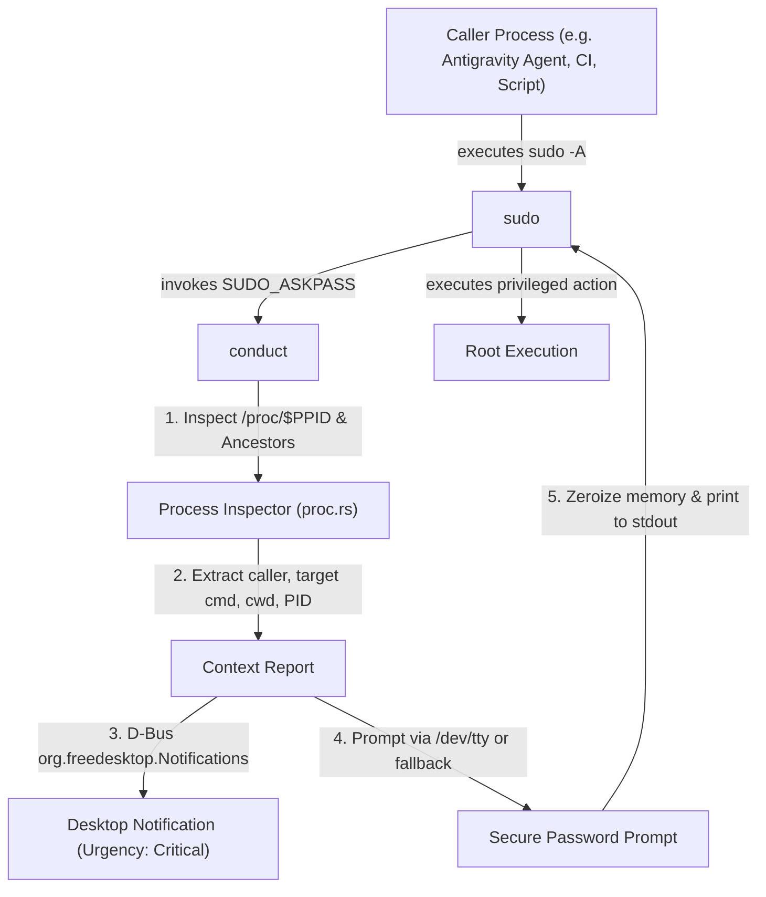

# conduct

> Context-aware, notification-driven askpass and privilege orchestrator for `sudo`, `SSH`, and `Polkit`.

[](LICENSE)
[](https://github.com/lithinnon/conduct/actions/workflows/ci.yml)

---

## Why conduct?

Standard askpass utilities (such as `ssh-askpass`, `ksshaskpass`, or generic GUI dialogs) present a blind prompt:
```
[sudo] password for alice:
```

When autonomous AI agents (e.g. Antigravity), background services, IDE runners, or build scripts execute `sudo -A` or privilege elevation commands, you have zero context:
- **Which process** triggered the escalation?
- **What exact command and arguments** does it intend to run with root privileges?
- **From which working directory** was the command invoked?
- **What is the ancestry chain** behind the request?

Without answers, granting privilege escalation becomes a leap of faith or a security hazard.

`conduct` turns privilege escalation into a **transparent, auditable, and context-rich interaction**.

---

## Features

- **Deep Process Ancestry Inspection**:
  Walks `/proc/$PPID` and ancestor processes to extract:
  - Command line (`cmdline`) of the caller and the target `sudo` execution.
  - Process name (`comm`) and executable path (`exe`).
  - Working directory (`cwd`).
  - Process ID (`pid`), parent PID (`ppid`), and user/UID metadata (`status`).
- **Desktop Notifications via D-Bus**:
  Dispatches immediate, critical notifications (`org.freedesktop.Notifications`, urgency=critical) with a full breakdown of the requesting process and target command.
  Auto-closes notifications over D-Bus the moment authentication completes or cancels, leaving zero stale notification toasts.
- **Supervisor Provenance Guard (Anti-Log-Leak)**:
  Direct askpass output is restricted to verified authentication supervisors (`sudo`, `doas`, `ssh`, `polkit`, `git`). Unsanctioned callers (such as background CI scripts, subagent pipes, or shell scripts) are prevented from capturing plaintext passwords into log files.
- **Secure Askpass Flow**:
  - Prioritizes graphical dialog prompts (`ksshaskpass`, `kdialog`, `zenity`) in headless/subagent sessions to prevent freezing on hidden TTYs.
  - Interactive terminal support with masked `/dev/tty` input via `rpassword`.
  - Guarantees memory zeroization using `zeroize` before drop.
  - Safe verification mode (`conduct test`) for testing dialogs and notifications without echoing credentials to stdout.
  - Fully compliant with `SUDO_ASKPASS`, `SSH_ASKPASS`, and `GIT_ASKPASS` conventions.
- **Declarative NixOS & Home Manager Modules**:
  Seamlessly integrates into NixOS and standalone Home Manager environments.

---

## How It Works



---

## CLI Usage

`conduct` can be invoked directly as an askpass handler, or explicitly via subcommands:

### 1. Default Askpass Mode
When invoked without subcommands (as `sudo` or `ssh` does):
```bash
conduct "[sudo] password for alice:"
```
Or exported in your environment:
```bash
export SUDO_ASKPASS="$(which conduct)"
export SSH_ASKPASS="$(which conduct)"
export SSH_ASKPASS_REQUIRE="force"

sudo -A systemctl restart something
```

### 2. Explicit Subcommands

#### `askpass`
Run the full askpass pipeline explicitly:
```bash
conduct askpass --prompt "[sudo] password for alice: "
```
Options:
- `--prompt <TEXT>`: Custom prompt text.
- `--no-notify`: Skip D-Bus desktop notification.
- `--pid <PID>`: Inspect a specific target PID instead of parent process.

#### `notify`
Send an elevation notification for a process without prompting for a password:
```bash
conduct notify --pid 12345 --summary "Privilege Elevation Requested"
```

#### `inspect`
Print the resolved process context and ancestry tree in JSON or human-readable format:
```bash
conduct inspect
conduct inspect --pid 12345 --json
```

---

## Installation & Flake Usage

### Run directly with Nix
```bash
nix run github:lithinnon/conduct -- --help
```

### Nix Flake Dev Shell
```bash
nix develop
```

### NixOS Module
In your `flake.nix`:
```nix
{
  inputs = {
    nixpkgs.url = "github:NixOS/nixpkgs/nixos-unstable";
    conduct.url = "github:lithinnon/conduct";
  };

  outputs = { self, nixpkgs, conduct, ... }: {
    nixosConfigurations.myhost = nixpkgs.lib.nixosSystem {
      system = "x86_64-linux";
      modules = [
        conduct.nixosModules.default
        {
          programs.conduct = {
            enable = true;
            enableSudoAskpass = true;
          };
        }
      ];
    };
  };
}
```

### Home Manager Module
```nix
{
  programs.conduct = {
    enable = true;
    enableSudoAskpass = true;
    enableSshAskpass = true;
  };
}
```

---

## Architecture & Deep Modules

- `src/proc.rs`:
  **Deep Process Inspector**: Hides parsing of `/proc/[pid]/{cmdline,comm,cwd,status}` and ancestor traversal behind a clean, simple query interface `ProcessContext::resolve(pid)`.
- `src/notify.rs`:
  **Desktop Notification Engine**: Abstracts D-Bus communication with `org.freedesktop.Notifications`, handling hints, urgency, and formatting.
- `src/askpass.rs`:
  **Askpass Orchestrator**: Coordinates process inspection, desktop notification, credential prompt, and memory zeroization.
- `src/main.rs`:
  **CLI Dispatcher**: Command-line interface with `clap`, supporting default askpass compatibility mode.

---

## License

GPL-3.0-or-later. See [LICENSE](LICENSE) for details.
